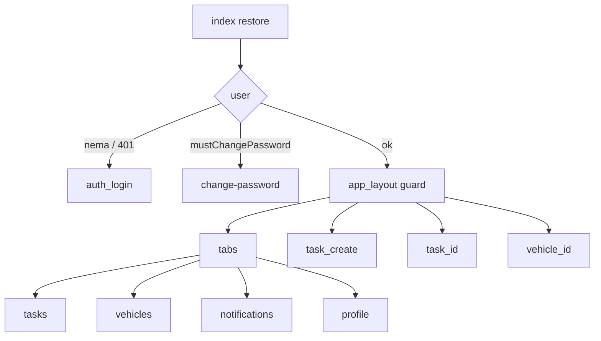

# Plan: mobilni audit + UX/UI usklađivanje

Izvor: [`audit/11-mobile-audit.md`](audit/11-mobile-audit.md), matrica [`.cursor/docs/matrices/mobile-app/MATRIX.md`](.cursor/docs/matrices/mobile-app/MATRIX.md), spec [`docs/06-UX_UI_DIZAJN.md`](docs/06-UX_UI_DIZAJN.md) §4.2 / §5 / §8 / §10.

**Nije u opsegu:** ZIP native replika; iOS target; GPS; offline queue; uključivanje `FIREBASE_ENABLED=true` na produkcijskom hostu (samo dokumentovati i ostaviti klijentski no-op dok nema `google-services.json` + tvoje potvrde); izmišljeni handover CRUD (backend `VEHICLE_HANDOVER`/`OTHER` nema list endpoint — [`form-option-values.ts`](apps/api/src/common/form-option-values.ts) je `null`).

Pri startu implementacije upisati fazne fajlove u `.cursor/plans/mobile-audit-impl/` (`00_overview.md`, `01_phase-*.md`, `CHECKLIST.md`, `CHANGELOG.md`, `HANDOFF.md`).

## Faza 1 — Temelj: tokeni, primitive, auth, P1 copy, split

- Proširiti [`apps/mobile/src/lib/theme.ts`](apps/mobile/src/lib/theme.ts) istim skalama kao web: `space` 4/8/12/16/24/32/48, `type` (mobilni base 16/24), `radius`, `controlMinHeight: 48`. Boje ostaju postojeći parovi (CI `design-tokens:check`).
- Novi primitive (svaki fajl <150 linija): `screen.tsx` (SafeAreaView + bg), `button.tsx`, `card.tsx`, `status-badge.tsx` (`statusLabel` iz `@vfm/shared`), `due-pill.tsx` (rokovi vozila), `empty-state.tsx`, `error-banner.tsx`, `skeleton.tsx`.
- Tanka i18n: `src/lib/i18n.ts` BS default + EN mapa; ekrani koriste ključeve za nove/izmijenjene stringove (M-18, bez masovnog extract-a u jednom diffu).
- **M-01:** u [`toUserMessage`](apps/mobile/src/lib/api.ts) za `MOBILE_ACCESS_FORBIDDEN` / `MOBILE_SCOPE_NOT_ALLOWED` koristiti spec copy iz §10. Ostali 403 ostaju generički.
- **M-02/M-03:** Expo Router grupa `app/(app)/` s layoutom koji `Redirect` na login ili change-password. Premjestiti `(tabs)`, `task/create`, `task/[id]`, `vehicle/[id]` unutra. `create.tsx` rani return ako nema `task:create`.
- **M-04:** u [`(tabs)/_layout.tsx`](<apps/mobile/app/(tabs)/_layout.tsx>) uvijek registrovati screenove; bez prava `href: null` + empty/403 stanje u ekranu. **tabBarBadge** na Obavijesti iz unread count.
- **M-10:** split `api.ts` (client/errors/types/resources), `dynamic-task-form.tsx` (FieldControl + upload helper), `profile.tsx` (sessions panel), `task/create.tsx` (koraci). Limit 200 linija.

## Faza 2 — UX/UI po ekranu (bez ZIP-a)

Uskladiti M1–M11 s §8 wireframeovima i §5 tokenima, koristeći primitive iz Faze 1:

- Login/lozinka: SafeArea, input 16px, CTA 48, spec Super Admin notice ostaje i kao helper i kao error (M-01).
- Zadaci: sticky/FAB 48 (ne header `+ Novi` visine 42); segmenti ≥48; kartice s `StatusBadge`; skeleton umjesto golog spinnera; datumi `dd.MM.yyyy HH:mm` Europe/Sarajevo.
- Detalj zadatka: sticky CTA 56 na dnu; prioritet kroz `statusLabel`; **409 claim dijalog** „Zadatak je preuzeo {ime}…” + Nazad/Osvježi (§8.2 / §10).
- Wizard: isti CTA/footer, datum rok `dd.MM.yyyy` (ne GGGG-MM-DD placeholder).
- Vozila: `DuePill` za registraciju/osiguranje/servis; VIN ostaje RO.
- Liste: `pageSize` ostaje; UI „Prikaži još” ako `total > items.length` (M-13, bez infinite scroll biblioteke).
- Profil: isti vizuelni ritam; IP sesije ostaje uz `auth:manage_sessions`.
- M11: offline banner „Nema internet veze…”; write akcije disabled; **nema keša** (M-E6 by design).

## Faza 3 — Forme i reference

- Jedan `FieldControl` + `upload-picked.ts` za create i complete (ukloniti dupli kamera/galerija kod).
- **M-15:** lookup catch → `toUserMessage` na polju, ne prazan niz.
- **M-16:** `TIRE_SETS_BY_VEHICLE` i dalje koristi postojeći `/tire-sets` (nema vehicleId filter na API-ju); dokumentovati + poruka ako `params.vehicleId` nedostaje; ne širiti API u ovom planu.
- **M-05:** za `VEHICLE_HANDOVER`/`OTHER` eksplicitna poruka „Ovaj tip zapisa nije dostupan u mobilnoj formi.” — ne novi backend modul.

## Faza 4 — Obavijesti, preferences, FCM klijent

API već postoji: `GET/PUT /notifications/preferences`, `POST/DELETE /devices/tokens` ([controller](apps/api/src/modules/notifications/device-tokens.controller.ts)). Web UI je uzor ([`notifications-page.tsx`](apps/web/src/features/notifications/notifications-page.tsx)).

- Profil ili sheet: switch in-app + push po `OUTBOX_EVENT_TYPES`; e-mail disabled + copy da e-mail nije aktivan; push copy da FCM zavisi od vlasničke Firebase konfiguracije. Dozvola `notification:manage_preferences`.
- [`app.json`](apps/mobile/app.json) / [`app.config.ts`](apps/mobile/app.config.ts): plugin `expo-notifications`, Android `POST_NOTIFICATIONS`; `googleServicesFile` samo ako fajl postoji (usklađeno, M-06).
- FCM tok (no-op bez native config):
  1. nakon login/restore, ako ima permisiju: `getPermissionsAsync` → `getDevicePushTokenAsync` → `POST /devices/tokens` `{ token, platform: 'android', … }`
  2. čuvati `deviceTokenId` u SecureStore (ne sam FCM string duže nego treba)
  3. logout / logout-all: `DELETE /devices/tokens/:id`
  4. tap notification → isti deep-link kao inbox (`TASK` / `VEHICLE`)
- **Ne** mijenjati default `FIREBASE_ENABLED=false` u API env. Push na uređaju radi tek kad: lokalni `google-services.json`, EAS preview/dev client (ne Expo Go), i vlasnik uključi Firebase na API-ju.
- Ukloniti mrtav import-path: zavisnost ostaje jer se sada koristi.

## Faza 5 — Maestro, dokumentacija, matrica

Novi tokovi pored postojećih P4 YAML-ova:

- **M-E5 / P1:** Super Admin seed nalog (isti disposable CI pattern kao admin/vozac) → vidljiv tačan spec tekst; nema tabova.
- **M-E2:** vozač → Slobodni → Preuzmi → „U toku” / tvoj zadatak (wash seed bez obavezne kamere ako je moguće).
- **M-E4-lite:** complete bez kamere ako forma dozvoljava; kamera mock nije pouzdan u CI — ne blokirati na pravom FCM.
- M-E3 concurrent i M-E7 logout: API već pokriva concurrency; Maestro logout smoke (nema push assertion dok FCM off).
- Ažurirati [`apps/mobile/README.md`](apps/mobile/README.md) (P4 nije „neizvršen”; FCM koraci; Expo Go vs dev build).
- Update `audit/11-*.md`, `MATRIX.md` + `CHANGELOG.md`, `08-status-registar.md` A-17, `docs/06` §9.2 statusi.

## Faza 6 — Verifikacija (agent + ti)

Agent: `pnpm typecheck` u `apps/mobile`; `design-tokens:check`; lint izmjena; Maestro YAML validan; bez produkcijskog API-ja/baze.

Ti: preview APK UAT checklist (login, Super Admin poruka, claim 409, kamera, sesije, tab deep-link, preferences, push ako Firebase upališ). Agent ne deploja i ne pali `FIREBASE_ENABLED` na hostu.
