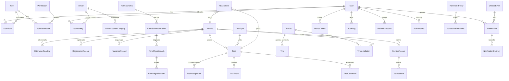

# 03 — Model podataka

**Verzija:** 1.0.0 · **Baza:** PostgreSQL 17 · **ORM:** Prisma 7.10 (migracije u Git-u)
**Pravila:** svi `createdAt/updatedAt/deletedAt` su `timestamptz` (UTC); novac je `integer` u
feninzima (1 KM = 100); e-mail je `citext`; identifikatori su `uuid v7` (vremenski poredak →
bolji indeksi); soft delete preko `deletedAt`; audit i objavljeni `FormSchemaVersion` su
immutabilni.

---

## 1. ER pregled



---

## 2. Enum-i

| Enum | Vrijednosti |
|---|---|
| `UserStatus` | `ACTIVE`, `SUSPENDED`, `DEACTIVATED`, `PENDING_PASSWORD_CHANGE` |
| `ClientType` | `WEB`, `MOBILE_ANDROID`, `MOBILE_IOS`, `SERVICE` |
| `RoleCode` | `SUPER_ADMIN`, `ADMINISTRATOR`, `OBICNI_KORISNIK`, `CUSTOM` |
| `PermissionScope` | `ALL`, `OWN`, `VEHICLE_IDS`, `DRIVER_IDS` |
| `FormSchemaStatus` | `DRAFT`, `PUBLISHED`, `RETIRED` |
| `FormSubject` | `VEHICLE`, `DRIVER`, `REGISTRATION`, `INSURANCE`, `SERVICE`, `TIRE_SET`, `TIRE_INSTALLATION`, `TASK`, `VEHICLE_HANDOVER`, `OTHER` |
| `FieldType` | `TEXT`, `TEXTAREA`, `INTEGER`, `DECIMAL`, `DATE`, `DATETIME`, `BOOLEAN`, `SINGLE_CHOICE`, `MULTI_CHOICE`, `DROPDOWN`, `MONEY`, `CURRENCY`, `PHOTO`, `FILE`, `REFERENCE_VEHICLE`, `REFERENCE_DRIVER`, `REFERENCE_RECORD`, `SECTION`, `COMPUTED` |
| `TaskStatus` | `OPEN`, `IN_PROGRESS`, `COMPLETED`, `CANCELLED` |
| `TaskPriority` | `LOW`, `NORMAL`, `HIGH`, `URGENT` |
| `TaskAssignMode` | `OPEN_CLAIM`, `ASSIGN_DIRECT`, `BROADCAST` |
| `TaskEventAction` | `CREATED`, `UPDATED`, `ASSIGNED`, `INVITED`, `CLAIMED`, `COMPLETED`, `CANCELLED`, `REOPENED`, `RELEASED`, `COMMENTED`, `ATTACHMENT_ADDED`, `OVERRIDE_COMPLETED`, `FORM_MIGRATED`, `EXPIRED` |
| `VehicleStatus` | `ACTIVE`, `IN_SERVICE`, `INACTIVE`, `DAMAGED`, `ARCHIVED` |
| `FuelType` | `DIESEL`, `PETROL`, `LPG`, `CNG`, `HYBRID`, `ELECTRIC` |
| `RecordStatus` | `DRAFT`, `ACTIVE`, `EXPIRED`, `CANCELLED`, `ARCHIVED` |
| `TireSeason` | `SUMMER`, `WINTER`, `ALL_SEASON` |
| `TireStatus` | `IN_STOCK`, `MOUNTED`, `IN_REPAIR`, `RETIRED`, `SCRAPPED` |
| `TirePosition` | `FL`, `FR`, `RL`, `RR`, `SPARE` |
| `AttachmentOwnerType` | `TASK`, `VEHICLE`, `SERVICE`, `REGISTRATION`, `INSURANCE`, `TIRE`, `DRIVER`, `REPORT_EXPORT`, `OTHER` |
| `AttachmentStage` | `ON_CREATE`, `ON_CLAIM`, `ON_COMPLETE`, `ON_CANCEL`, `GENERAL` |
| `OutboxStatus` | `PENDING`, `PROCESSING`, `PROCESSED`, `FAILED`, `DEAD` |
| `NotificationStatus` | `PENDING`, `SENT`, `READ`, `FAILED` |
| `DeliveryStatus` | `QUEUED`, `SENT`, `DELIVERED`, `FAILED`, `TOKEN_INVALID` |
| `DeviceTokenStatus` | `ACTIVE`, `INVALID`, `UNREGISTERED`, `DISABLED` |
| `AuditAction` | `CREATE`, `UPDATE`, `DELETE`, `ARCHIVE`, `RESTORE`, `LOGIN`, `LOGOUT`, `LOGIN_FAILED`, `PERMISSION_CHANGE`, `ROLE_CHANGE`, `FORM_PUBLISH`, `FORM_RETIRE`, `FORM_MIGRATE`, `EXPORT`, `FILE_ACCESS`, `SECURITY`, `SETTINGS_CHANGE`, `CLAIM`, `COMPLETE`, `CANCEL`, `REOPEN`, `RELEASE` |
| `AuditSeverity` | `INFO`, `WARN`, `SECURITY`, `CRITICAL` |
| `ReminderKind` | `REGISTRATION`, `INSURANCE`, `SERVICE_DATE`, `SERVICE_KM`, `DRIVER_LICENSE`, `TECHNICAL_INSPECTION`, `TIRE_ROTATION`, `CUSTOM` |
| `ReminderStatus` | `SCHEDULED`, `SENT`, `ACKNOWLEDGED`, `SNOOZED`, `CANCELLED` |
| `OdometerSource` | `MANUAL`, `TASK`, `SERVICE`, `REGISTRATION`, `INSURANCE`, `TIRE`, `HANDOVER`, `SYSTEM` |
| `MigrationJobStatus` | `PENDING`, `PREVIEW`, `RUNNING`, `COMPLETED`, `FAILED`, `ROLLED_BACK` |
| `ExportFormat` | `PDF`, `XLSX`, `CSV` |
| `ExportStatus` | `QUEUED`, `RUNNING`, `DONE`, `FAILED`, `EXPIRED` |
| `SettingType` | `STRING`, `INTEGER`, `DECIMAL`, `BOOLEAN`, `DATE`, `ENUM`, `JSON`, `SECRET` |

---

## 3. Entiteti

> Tipovi: `uuid`, `text`, `int`, `bigint`, `bool`, `date`, `timestamptz`, `jsonb`, `enum`.
> **PK** = primarni ključ, **FK** = strani ključ, **UQ** = unique, **IDX** = index.

### 3.1 Identitet i prava

#### `User`
| Polje | Tip | Ograničenja | Napomena |
|---|---|---|---|
| id | uuid | PK, v7 | |
| email | citext | UQ (partial `WHERE "deletedAt" IS NULL`), NOT NULL | |
| passwordHash | text | NOT NULL | argon2id |
| firstName, lastName | text | NOT NULL | |
| displayName | text | | generisan ako prazan |
| phone | text | | E.164 preporučeno |
| status | UserStatus | NOT NULL, default `ACTIVE` | |
| mustChangePassword | bool | default `false` | nakon bootstrap/reset-a |
| tokenVersion | int | NOT NULL, default `0` | bump = odjava svih sesija |
| ~~twoFactorEnabled / twoFactorSecret~~ | — | **uklonjeno** | 2FA se NE implementira (R-05, odluka vlasnika 19.10.2026.) |
| lastLoginAt | timestamptz | | |
| failedLoginCount | int | default 0 | reset pri uspješnoj prijavi |
| lockedUntil | timestamptz | | lockout |
| timezone | text | default `Europe/Sarajevo` | |
| locale | text | default `bs` | |
| createdById | uuid | FK User | |
| createdAt/updatedAt | timestamptz | | |
| deletedAt | timestamptz | IDX | soft delete |

**IDX:** `(status)`, `(email)`, `(lastName, firstName)` · **PRAVILO:** DB trigger zabranjuje
deaktivaciju/brisanje posljednjeg aktivnog `SUPER_ADMIN` korisnika (§3.2).

#### `Role`
| Polje | Tip | Ograničenja |
|---|---|---|
| id | uuid | PK |
| code | text | UQ, NOT NULL (`SUPER_ADMIN`, `ADMINISTRATOR`, `OBICNI_KORISNIK`, `CUSTOM_*`) |
| name | text | NOT NULL |
| description | text | |
| isSystem | bool | default `false` (sistemske role se ne brišu) |
| allowedClientTypes | ClientType[] | default `{WEB, MOBILE_ANDROID}`; za `SUPER_ADMIN` = `{WEB}` |
| permissionsVersion | int | NOT NULL default 0 (bump pri promjeni prava) |
| priority | int | default 100 (za prikaz i tie-breaking) |
| createdAt/updatedAt/deletedAt | timestamptz | |

#### `Permission`
| Polje | Tip | Ograničenja |
|---|---|---|
| id | uuid | PK |
| code | text | UQ, NOT NULL (npr. `vehicle:create`) |
| module | text | NOT NULL (`vehicles`, `tasks`, …) |
| action | text | NOT NULL (`view`, `create`, `update`, `archive`, `delete`, `assign`, `claim`, `complete`, `complete_override`, `export`, `manage_schema`, `publish_version`, `view_pii`) |
| description | text | |
| isSensitive | bool | default `false` (PII, export, override) |
| createdAt | timestamptz | |

**UQ:** `(module, action)` · **IDX:** `(module)`

#### `RolePermission`
| Polje | Tip | Ograničenja |
|---|---|---|
| id | uuid | PK |
| roleId | uuid | FK Role, ON DELETE CASCADE |
| permissionId | uuid | FK Permission, ON DELETE CASCADE |
| scope | PermissionScope | NOT NULL default `ALL` |
| scopeVehicleIds | uuid[] | koristi se kad `scope=VEHICLE_IDS` |
| scopeDriverIds | uuid[] | koristi se kad `scope=DRIVER_IDS` |
| conditions | jsonb | opciono (npr. `{"onlyOwnTasks": true}`) |
| grantedById | uuid | FK User |
| grantedAt | timestamptz | |

**UQ:** `(roleId, permissionId)`

#### `UserRole`
| id, userId FK, roleId FK, assignedById FK, assignedAt, note, validFrom, validUntil (opciono), revokedAt |
**UQ:** `(userId, roleId)` · **IDX:** `(userId)`

#### `UserIdentity`
Veza nalog ↔ vozač (korisnik ne mora biti vozač; vozač ne mora imati nalog).
| id, userId FK User (UQ partial), driverId FK Driver (UQ partial), isPrimary bool, createdAt |

#### `RefreshSession`
| id (uuid PK), userId FK, tokenHash text UQ NOT NULL (sha256), familyId uuid (za reuse detection), clientType ClientType, deviceInfo jsonb, ipAddress inet, userAgent text, expiresAt timestamptz, revokedAt timestamptz, replacedById uuid, lastUsedAt, createdAt |
**IDX:** `(userId, expiresAt)`, `(familyId)`

#### `AuthAttempt`
| id, email text, userId uuid nullable, success bool, clientType, ipAddress inet, userAgent text, failureReason text, createdAt |
**IDX:** `(email, createdAt)`, `(ipAddress, createdAt)` · retencija: 180 dana (maintenance job)

---

### 3.2 Zaštita posljednjeg Super Admina (DB nivo)

```sql
CREATE OR REPLACE FUNCTION vfm_guard_last_super_admin() RETURNS trigger AS $$
DECLARE active_count int;
BEGIN
  SELECT count(*) INTO active_count
    FROM "User" u
    JOIN "UserRole" ur ON ur."userId" = u.id AND ur."revokedAt" IS NULL
    JOIN "Role" r      ON r.id = ur."roleId" AND r.code = 'SUPER_ADMIN'
   WHERE u.status = 'ACTIVE' AND u."deletedAt" IS NULL
     AND u.id <> COALESCE(NEW.id, OLD.id);
  IF active_count = 0 THEN
    RAISE EXCEPTION 'LAST_SUPER_ADMIN_PROTECTED: sistem mora imati barem jednog aktivnog Super Admina';
  END IF;
  RETURN COALESCE(NEW, OLD);
END $$ LANGUAGE plpgsql;

-- Trigger-i: deaktivacija/brisanje korisnika, revokacija/brisanje SUPER_ADMIN role
```

---

### 3.3 Vozila i evidencije

#### `Vehicle`
| Polje | Tip | Ograničenja |
|---|---|---|
| id | uuid | PK |
| internalNo | text | NOT NULL, **UQ partial** `WHERE "deletedAt" IS NULL` |
| make, model | text | NOT NULL |
| year | int | CHECK `1950..2100` |
| vin | text | **UQ partial** `WHERE vin IS NOT NULL AND "deletedAt" IS NULL`, CHECK `length=17` ako nije NULL |
| plateNumber | text | IDX (nije UQ — historija registracija je u `RegistrationRecord`) |
| fuelType | FuelType | NOT NULL |
| transmission | text | |
| color | text | |
| bodyType | text | |
| engineCcm | int | |
| enginePowerKw | int | |
| seats | int | |
| ownershipType | text | default `OWNED` (`OWNED`, `LEASED`, `RENTED`) — R-08 |
| acquisitionDate | date | |
| acquisitionPrice | int | feninzi |
| costCenter | text | |
| odometerKm | int | NOT NULL default 0 (denormalizovano iz `OdometerReading`) |
| odometerUpdatedAt | timestamptz | |
| status | VehicleStatus | NOT NULL default `ACTIVE` |
| registrationExpiresAt | date | IDX (denormalizovano, sync iz aktivne registracije) |
| insuranceExpiresAt | date | IDX (denormalizovano) |
| nextServiceDueDate | date | IDX |
| nextServiceDueKm | int | IDX |
| photoAttachmentId | uuid | FK Attachment |
| notes | text | |
| formSchemaId / formSchemaVersionId | uuid | FK; **obavezno** pri kreiranju |
| formData | jsonb | NOT NULL default `{}` |
| version | int | NOT NULL default 0 (optimistic lock) |
| createdById, createdAt, updatedAt, deletedAt, archivedAt | | |

**IDX:** `(status)`, `(registrationExpiresAt)`, `(insuranceExpiresAt)`, `(nextServiceDueDate)`,
`(make, model)` · **CHECK:** `odometerKm >= 0`, `year BETWEEN 1950 AND 2100`

#### `OdometerReading`
| id, vehicleId FK, valueKm int NOT NULL CHECK ≥ 0, source OdometerSource, referenceType text (`TASK`/`SERVICE`/…), referenceId uuid, readingAt timestamptz NOT NULL, recordedById FK User, isCorrection bool default false, correctionReason text, previousValueKm int, createdAt |
**UQ:** `(vehicleId, readingAt, valueKm, source)` (sprječava dupli upis istog događaja) ·
**IDX:** `(vehicleId, readingAt DESC)` · **PRAVILO (servis):** nova vrijednost < max dosadašnje →
`422 ODOMETER_REGRESSION`, osim `isCorrection=true` + `correctionReason` + audit.

#### `RegistrationRecord`
| id, vehicleId FK, formSchemaId, formSchemaVersionId, formData jsonb, registrationNumber text NOT NULL, validFrom date NOT NULL, validUntil date NOT NULL, issuedBy text, costAmount int, currency char(3) default `BAM`, attachmentIds uuid[], status RecordStatus, notes text, createdById, createdAt, updatedAt, deletedAt, version int |
**CHECK:** `validUntil > validFrom` ·
**EXCLUDE:** `EXCLUDE USING gist ("vehicleId" WITH =, daterange("validFrom","validUntil",'[]') WITH &&) WHERE ("deletedAt" IS NULL)` → **B-10** ·
**IDX:** `(vehicleId, validUntil DESC)`, `(validUntil)`

#### `InsuranceRecord`
| id, vehicleId FK, formSchema*, policyNumber text, insuranceCompany text, type text (`KASKO`, `ODGOVORNOST`, `PUTNIKO`, …), validFrom date, validUntil date, premiumAmount int, currency, deductibleAmount int, attachmentIds uuid[], status RecordStatus, notes, createdById, createdAt, updatedAt, deletedAt, version |
**CHECK + EXCLUDE:** isto kao `RegistrationRecord` · **IDX:** `(validUntil)`

#### `ServiceRecord`
| id, vehicleId FK, formSchema*, serviceDate date NOT NULL, odometerKm int, serviceType text NOT NULL, workshopId uuid FK ListItem, workshopName text, description text, partsReplaced text, laborCost int, partsCost int, totalCost int NOT NULL CHECK ≥ 0, currency char(3) default `BAM`, nextServiceDueDate date, nextServiceDueKm int, invoiceNumber text, attachmentIds uuid[], status RecordStatus, notes, createdById, createdAt, updatedAt, deletedAt, version |
**CHECK:** `nextServiceDueDate IS NOT NULL OR nextServiceDueKm IS NOT NULL` (ako je politika
uključena) · **IDX:** `(vehicleId, serviceDate DESC)`, `(nextServiceDueDate)`, `(serviceType)`

#### `ServiceItem`
| id, serviceRecordId FK ON DELETE CASCADE, kind text (`PART`/`LABOR`/`FLUID`/`OTHER`), name text NOT NULL, quantity decimal(10,2) default 1, unitPrice int, totalPrice int NOT NULL, partNumber text, notes, position int |
**IDX:** `(serviceRecordId)`

#### `Driver`
| id, firstName, lastName, phone, email, dateOfBirth date, address text, employeeNumber text, employmentStatus text, licenseNumber text (**PII**), licenseIssuedAt date, licenseExpiresAt date IDX, licenseIssuingAuthority text, restrictions text, notes text, status text default `ACTIVE`, photoAttachmentId uuid, formSchema*, formData jsonb, version int, createdById, createdAt, updatedAt, deletedAt |
**IDX:** `(lastName, firstName)`, `(licenseExpiresAt)` · **PII:** `licenseNumber`, `dateOfBirth`,
`address`, `phone`, `email` se vraćaju samo uz `driver:view_pii` (**B-20**), inače redigovano.

#### `DriverLicenseCategory`
| id, driverId FK ON DELETE CASCADE, category text NOT NULL (`B`, `C`, `CE`, …), issuedAt date, expiresAt date, restrictions text, notes |
**UQ:** `(driverId, category)` · **IDX:** `(expiresAt)`

---

### 3.4 Gume

#### `TireSet`
| id, code text NOT NULL **UQ partial**, brand text, model text, size text (`205/55R16 91V`), width int, aspectRatio int, diameterInches numeric(4,1), loadIndex int, speedIndex text, season TireSeason, tireCount int default 4 CHECK 1..8, purchaseDate date, purchasePrice int, currency, status TireStatus, currentLocation text, notes, formSchema*, formData, version, createdById, createdAt, updatedAt, deletedAt |
**IDX:** `(season, status)`, `(code)`

#### `Tire`
| id, setId uuid FK TireSet (nullable — pojedinačna guma), serialNumber text, dot text, productionWeek int, productionYear int, position TirePosition, treadDepthMm numeric(4,1), status TireStatus, purchaseDate date, purchasePrice int, notes, formData, createdAt, updatedAt, deletedAt |
**UQ:** `(setId, position)` partial `WHERE "setId" IS NOT NULL AND "deletedAt" IS NULL` ·
**IDX:** `(status)`

#### `TireInstallation`
| id, setId uuid FK TireSet NOT NULL, vehicleId uuid FK Vehicle NOT NULL, mountedAt date NOT NULL, mountedOdometerKm int NOT NULL, dismountedAt date, dismountedOdometerKm int, reason text (`SEASONAL_SWAP`, `DAMAGE`, `WEAR`, `SALE`, `REPAIR`), positions TirePosition[], storageLocationOnDismount text, daysInUse int, kmDriven int, formSchema*, formData, version, createdById, createdAt, updatedAt, deletedAt |
**UQ (ključno — B-09):** `CREATE UNIQUE INDEX ux_tire_installation_active ON "TireInstallation"("setId") WHERE "dismountedAt" IS NULL AND "deletedAt" IS NULL;`
**CHECK:** `dismountedAt IS NULL OR dismountedAt >= mountedAt`;
`dismountedOdometerKm IS NULL OR dismountedOdometerKm >= mountedOdometerKm`;
`daysInUse`/`kmDriven` se popunjavaju pri demontaži (i ostaju snapshot).
**IDX:** `(vehicleId, mountedAt DESC)`, `(setId, mountedAt DESC)`

**Operacija `swap`** (U-14): jedna transakcija → `UPDATE` stare instalacije (dismount) + `INSERT`
nove (mount) + `OdometerReading` + outbox + audit.

---

### 3.5 Forme

#### `FormSchema`
| id, key text NOT NULL **UQ** (npr. `task.WASH`, `vehicle.core`), name text NOT NULL, subject FormSubject NOT NULL, taskTypeId uuid FK (obavezno kad `subject=TASK`), description text, status text default `ACTIVE`, currentPublishedVersionId uuid, ownerModule text, createdAt, updatedAt, deletedAt, createdById |
**UQ:** `(subject, taskTypeId)` partial `WHERE "subject"='TASK' AND "deletedAt" IS NULL`

#### `FormSchemaVersion`
| id, formSchemaId FK, version int NOT NULL, status FormSchemaStatus NOT NULL, definition jsonb NOT NULL, contentHash text, changeNote text, publishedAt timestamptz, publishedById uuid, retiredAt timestamptz, retiredById uuid, createdAt, createdById, normalizedName jsonb (`[{fieldKey, column, transform}]`), compatibility jsonb, mobileCompatible bool default true |
**UQ:** `(formSchemaId, version)` · **IDX:** `(formSchemaId, status, publishedAt DESC)` ·
**IMMUTABILNOST:** DB trigger odbija `UPDATE definition/version/status→DRAFT` i `DELETE` kada je
`status='PUBLISHED'` (dozvoljen samo prelaz `PUBLISHED→RETIRED` uz `retiredById`).

#### `FieldKeyRegistry`
| id, key text NOT NULL **UQ**, dataType text NOT NULL, unit text, normalizedColumn text, usedByFormSchemaIds uuid[], createdAt, updatedAt |
**Svrha (U-16):** isti ključ = isti tip i značenje u svim formama.

#### `FormMigrationJob` / `FormMigrationItem`
`FormMigrationJob`: id, formSchemaId, fromVersionId, toVersionId, targetEntityType text,
targetEntityIds uuid[] (ili filter jsonb), status MigrationJobStatus, previewResult jsonb,
requestedById, startedAt, finishedAt, summary jsonb (`{total, ok, failed, skipped}`), notes.
`FormMigrationItem`: id, jobId FK, entityId uuid, before jsonb, after jsonb, status text, error text,
processedAt. **UQ:** `(jobId, entityId)`.

---

### 3.6 Zadaci

#### `TaskType`
| id, code text NOT NULL **UQ**, name text NOT NULL, description text, iconName text, colorHex text, requiresVehicle bool default true, requiresOdometer bool default false, requiresPhotos bool default false, defaultPriority TaskPriority default `NORMAL`, defaultAssignMode TaskAssignMode default `OPEN_CLAIM`, allowMultipleClaimants bool default false, dueOffsetHours int, formSchemaId uuid FK, active bool default true, sortOrder int, createdAt, updatedAt, deletedAt, createdById |

Seed: `WASH`, `INTERIOR_CLEANING`, `FUEL_REFILL`, `SERVICE_VISIT`, `TIRE_CHANGE`,
`TECHNICAL_INSPECTION`, `REGISTRATION`, `CUSTOM`.

#### `Task`
| Polje | Tip | Ograničenja |
|---|---|---|
| id | uuid | PK |
| code | text | **UQ** (npr. `Z-2026-000123`) — čitljiv u komunikaciji |
| title | text | NOT NULL |
| description | text | |
| vehicleId | uuid | FK; NOT NULL ako `TaskType.requiresVehicle` |
| taskTypeId | uuid | FK NOT NULL |
| priority | TaskPriority | NOT NULL default `NORMAL` |
| status | TaskStatus | NOT NULL default `OPEN` |
| assignMode | TaskAssignMode | NOT NULL default `OPEN_CLAIM` |
| createdById | uuid | FK User NOT NULL |
| assigneeUserId | uuid | FK User (denormalizovano iz `TaskAssignment`) |
| claimedAt | timestamptz | |
| completedAt | timestamptz | |
| completedById | uuid | FK (override slučaj) |
| dueAt | timestamptz | IDX |
| dueDate | date | IDX |
| cancelledAt | timestamptz | |
| cancelReason | text | |
| reopenedAt / releasedAt | timestamptz | |
| durationMinutes | int | računa se pri završetku |
| odometerKm | int | CHECK ≥ 0 |
| totalCost | int | feninzi |
| fuelLiters / fuelAmount / fuelConsumptionL100 | numeric/int | **N-01** (za `FUEL_REFILL`) |
| formSchemaId / formSchemaVersionId | uuid | NOT NULL |
| formData | jsonb | NOT NULL default `{}` |
| version | int | NOT NULL default 0 |
| idempotencyKey | text | **UQ partial** |
| createdAt/updatedAt/deletedAt | timestamptz | |

**IDX:** `(status, dueAt)`, `(vehicleId, createdAt DESC)`, `(assigneeUserId, status)`,
`(taskTypeId, status)`, `(createdById, createdAt DESC)`
**CHECK:** `status <> 'COMPLETED' OR (assigneeUserId IS NOT NULL AND completedAt IS NOT NULL)`;
`status <> 'IN_PROGRESS' OR assigneeUserId IS NOT NULL`
**STATUSNA MAŠINA (U-05)** — dozvoljene tranzicije: `OPEN→IN_PROGRESS`, `OPEN→CANCELLED`,
`IN_PROGRESS→COMPLETED`, `IN_PROGRESS→CANCELLED`, `IN_PROGRESS→OPEN` (release),
`CANCELLED→OPEN` (reopen), `COMPLETED→IN_PROGRESS` (samo `task:reopen` + audit).

#### `TaskAssignment`
| id, taskId FK ON DELETE CASCADE, userId FK User, role text (`INVITED`/`ASSIGNEE`/`OBSERVER`), assignedById FK, assignedAt, revokedAt, note |
**UQ:** `(taskId, userId, role)` ·
**UQ (drugi pojas za P6):** `ux_task_assignment_assignee ON "TaskAssignment"("taskId") WHERE role='ASSIGNEE' AND "revokedAt" IS NULL`

#### `TaskEvent`  (immutabilan)
| id, taskId FK, action TaskEventAction, actorId uuid FK User, actorRole text, at timestamptz NOT NULL default now(), ipAddress inet, clientType ClientType, requestId text, data jsonb, formSchemaVersionId uuid |
**IDX:** `(taskId, at)`, `(actorId, at)` · **BEZ `updatedAt`/`deletedAt`** + trigger koji odbija
`UPDATE`/`DELETE`.

#### `TaskComment`
| id, taskId FK, authorId FK, body text NOT NULL, mentionsUserIds uuid[], createdAt, updatedAt, deletedAt |

#### `TaskCompletionRequirement`
| id, taskTypeId FK, fieldKey text NOT NULL, required bool default true, stage AttachmentStage, minPhotos int default 0 |
**UQ:** `(taskTypeId, fieldKey)` — omogućava da Super Admin traži npr. obaveznu fotografiju „prije
i poslije" za pranje vozila.

---

### 3.7 Obavijesti i outbox

#### `OutboxEvent`
| id, aggregateType text (`TASK`, `REGISTRATION`, …), aggregateId uuid, eventType text (`TASK_CREATED`, `TASK_CLAIMED`, `TASK_COMPLETED`, `TASK_RELEASED`, `TASK_CANCELLED`, `REMINDER_DUE`, …), payload jsonb NOT NULL, idempotencyKey text **UQ**, status OutboxStatus default `PENDING`, attempts int default 0, lastError text, lockedAt timestamptz, lockedBy text, availableAt timestamptz default now(), processedAt timestamptz, createdAt |
**IDX:** `(status, availableAt)` partial `WHERE status IN ('PENDING','FAILED')`

#### `Notification`
| id, userId FK NOT NULL, type text NOT NULL, title text NOT NULL, body text, data jsonb, linkToType text, linkToId uuid, priority text default `NORMAL`, status NotificationStatus default `PENDING`, isRead bool default false, readAt timestamptz, createdAt timestamptz NOT NULL, sentAt timestamptz, outboxEventId uuid FK, notificationKey text NOT NULL **UQ**, dedupeKey text **UQ**, expiresAt timestamptz |
**IDX:** `(userId, isRead, createdAt DESC)`, `(userId, createdAt DESC)`

`dedupeKey` = `{type}:{linkToType}:{linkToId}:{bucket}` (npr. `bucket` = datum za podsjetnike) —
garantuje **jednu** in-app obavijest po događaju (**B-13**).

#### `NotificationDelivery`
| id, notificationId FK, channel text (`FCM`, `SSE`, `EMAIL`), deviceTokenId uuid FK, status DeliveryStatus, providerMessageId text, errorCode text, errorMessage text, attempts int default 0, sentAt, deliveredAt, createdAt |
**IDX:** `(notificationId)`, `(status, createdAt)`

#### `DeviceToken`
| id, userId FK NOT NULL, token text NOT NULL, tokenHash text NOT NULL **UQ**, platform text default `android`, appVersion text, deviceModel text, osVersion text, locale text, status DeviceTokenStatus default `ACTIVE`, lastSeenAt timestamptz, lastError text, failureCount int default 0, createdAt, revokedAt |
**IDX:** `(userId, status)`

#### `NotificationPreference`
| id, userId FK, type text NOT NULL, channelFcm bool default true, channelInApp bool default true, channelEmail bool default false, quietHoursStart time, quietHoursEnd time, createdAt, updatedAt |
**UQ:** `(userId, type)`

---

### 3.8 Podsjetnici

#### `ReminderPolicy`
| id, kind ReminderKind **UQ**, enabled bool default true, thresholdsDays int[] default `{5}`, thresholdsKm int[] default `{}`, recipientsPermission text default `vehicle:view`, recipientRoleIds uuid[], channel text[] default `{IN_APP, FCM}`, escalate bool default false, notes, createdAt, updatedAt |

#### `ScheduledReminder`
| id, policyId FK, kind ReminderKind, entityType text, entityId uuid, dueDate date, dueKm int, thresholdDays int, thresholdKm int, fireAt timestamptz, status ReminderStatus default `SCHEDULED`, dedupeKey text NOT NULL **UQ**, sentAt, acknowledgedById uuid, acknowledgedAt, outboxEventId uuid, createdAt |
**IDX:** `(status, fireAt)` · **UQ `dedupeKey`** = `{kind}:{entityType}:{entityId}:{dueDate|dueKm}:{threshold}`

---

### 3.9 Prilozi

#### `Attachment`
| id uuid PK, ownerId uuid NOT NULL, ownerType AttachmentOwnerType NOT NULL, stage AttachmentStage default `GENERAL`, fileName text NOT NULL (original), storageKey text NOT NULL **UQ** (relativna putanja, npr. `2026/10/ab/ab12…jpg`), mimeType text NOT NULL, ext text NOT NULL, sizeBytes bigint NOT NULL, sha256 text NOT NULL, width int, height int, exifStripped bool default true, uploadedById uuid FK User NOT NULL, taskId uuid FK (nullable), formFieldKey text, createdAt, deletedAt |
**IDX:** `(ownerType, ownerId)`, `(sha256)`, `(uploadedById, createdAt)` ·
**UQ:** `(ownerType, ownerId, sha256)` — deduplikacija istog fajla ·
**PRAVILO:** fajl se nikad ne servira direktno s diska; isključivo `GET /attachments/:id/content`
uz permisiju + potpisani URL (**B-15**).

---

### 3.10 Audit, postavke, šifarnici, izvještaji

#### `AuditLog` (immutabilan)
| id bigint GENERATED ALWAYS AS IDENTITY PK, actorId uuid, actorEmail text, actorRoles text[], action AuditAction, severity AuditSeverity default `INFO`, entityType text, entityId uuid, entityCode text, before jsonb, after jsonb, changedFields text[], reason text, requestId text, ipAddress inet, userAgent text, clientType ClientType, metadata jsonb, createdAt timestamptz NOT NULL default now() |
**IDX:** `(entityType, entityId, createdAt DESC)`, `(actorId, createdAt DESC)`, `(action, createdAt DESC)`, `(severity, createdAt DESC)` ·
trigger odbija `UPDATE`/`DELETE`; retencija kroz `AUDIT_RETENTION_DAYS` (0 = trajno).

#### `Setting`
| id, key text NOT NULL **UQ**, value jsonb NOT NULL, type SettingType NOT NULL, schema jsonb (validacija), category text, isSecret bool default false, isPublic bool default false, description text, updatedById, updatedAt, createdAt |

#### `List` / `ListItem` (šifarnici — U-21)
`List`: id, code text **UQ** (`FUEL_TYPE`, `WORKSHOP`, `STORAGE_LOCATION`, `CANCEL_REASON`, …),
name, description, isSystem bool, sortOrder.
`ListItem`: id, listId FK, code text, label text NOT NULL, value jsonb, sortOrder int, active bool
default true, parentId uuid (hijerarhija), createdAt, updatedAt, deletedAt.
**UQ:** `(listId, code)`

#### `IdempotencyKey`
| id, key text NOT NULL, userId uuid NOT NULL, method text, path text, requestHash text NOT NULL, responseStatus int, responseBody jsonb, createdAt timestamptz, expiresAt timestamptz NOT NULL |
**UQ:** `(userId, key)` · **IDX:** `(expiresAt)` · TTL 24 h (maintenance job čisti)

#### `ReportDefinition`
| id, code text **UQ**, name text, category text (`VEHICLE`, `USER`, `GENERAL`), sourceView text NOT NULL, columns jsonb, defaultFilters jsonb, requiredPermission text NOT NULL, isSystem bool, sortOrder, createdAt, updatedAt |

#### `ExportJob`
| id, reportDefinitionId FK, format ExportFormat, filters jsonb, status ExportStatus, requestedById uuid, rowCount int, attachmentId uuid FK, errorMessage text, startedAt, finishedAt, expiresAt, createdAt |
**IDX:** `(requestedById, createdAt DESC)`, `(status)`

---

## 4. SQL view-ovi za izvještaje (Faza 7)

| View | Sadržaj |
|---|---|
| `vfm_v_vehicle_overview` | vozilo + trenutna registracija/osiguranje + km + status + rokovi |
| `vfm_v_vehicle_costs` | troškovi po vozilu i kategoriji (servis, registracija, osiguranje, gorivo, gume, zadaci) po mjesecu |
| `vfm_v_task_stats` | zadaci po tipu/statusu/korisniku/periodu + `durationMinutes` |
| `vfm_v_user_activity` | preuzeti/završeni/otkazani zadaci po korisniku + broj pranja |
| `vfm_v_deadlines` | svi rokovi (registracija, osiguranje, servis datum/km, dozvola, tehnički) s `daysUntil` |
| `vfm_v_tire_usage` | ciklusi guma: dani, km, vozila, sezona |
| `vfm_v_fuel_consumption` | potrošnja L/100 km po vozilu i periodu (**N-01**) |

**Pravilo:** view-ovi čitaju **isključivo normalizovane kolone**, nikad `formData` JSONB (U-03).

---

## 5. Prisma smjernice

1. `schema.prisma` koristi `postgresqlExtensions` preview feature za `pgcrypto`, `btree_gist`, `citext`.
2. Sve što Prisma ne može izraziti (CHECK, EXCLUDE, trigger, partial unique index, identity kolona)
   dodaje se **ručno** u `migration.sql` nakon `prisma migrate diff`, i to tako da je migracija
   **idempotentna** (`IF NOT EXISTS`, `CREATE OR REPLACE FUNCTION`).
3. Nikad `prisma db push` nad produkcijskom bazom; isključivo `prisma migrate deploy`.
4. Atomski `claim`, `swap` guma i `publish` forme idu kroz `$transaction` + `$executeRaw`
   (parametrizirano — bez string interpolacije).
5. Soft delete se implementira kroz Prisma **client extension** (`$extends`) koji automatski dodaje
   `where.deletedAt = null`, uz eksplicitan `withDeleted` opt-in za izvještaje.
6. JSONB polja (`formData`, `definition`, `payload`) se **ne** filtriraju u WHERE-u za liste;
   za to postoje normalizovane kolone.
7. Deklarativni tipovi: novac `Int`, kilometraža `Int`, decimalne količine `Decimal(10,2)`,
   datum `DateTime @db.Date`, timestamp `DateTime @db.Timestamptz(6)`.

---

## 6. Retencija i čišćenje podataka

| Podatak | Retencija | Mehanizam |
|---|---|---|
| `AuditLog`, `TaskEvent` | trajno (konfigurabilno `AUDIT_RETENTION_DAYS`) | maintenance job |
| `AuthAttempt` | 180 dana | maintenance job |
| `IdempotencyKey` | 24 h | TTL indeks + job |
| `OutboxEvent` (PROCESSED) | 30 dana | job |
| `Notification` (READ, starije od 90 dana) | arhiviranje/brisanje | job |
| `ExportJob` + fajl | `REPORT_EXPORT_RETENTION_DAYS` (7) | job |
| `Attachment` (soft delete) | 90 dana pa fizičko brisanje fajla | job (dvokoračno, s provjerom referenci) |
| `RefreshSession` (istekla) | 30 dana | job |

---

## 7. Seed plan (dev/demo — bez stvarnih ličnih podataka)

- 3 sistemske role + 1 primjer custom role; kompletan katalog permisija (iz `05-…md` §3).
- 1 Super Admin (kreiran kroz `bootstrap-super-admin.mjs`, **ne** kroz seed u produkciji).
- 2 administratora, 2 obična korisnika (generisane lozinke, `mustChangePassword=true`).
- **10 izmišljenih vozila** (`V-001`…`V-010`) s registracijom/osiguranjem: 1 istekla, 1 ističe za
  3 dana, 1 za 20 dana; 4 servisa; 3 seta guma s 2 ciklusa; 5 vozača s kategorijama (1 dozvola
  ističe za 20 dana).
- 8 vrsta zadataka + objavljene forme za svaku; 20 zadataka u različitim statusima; 30 `TaskEvent`-ova.
- Šifarnici: goriva, radionice, lokacije skladišta, razlozi otkazivanja.
- Postavke: pragovi podsjetnika, valuta, TZ, fiskalna godina.
